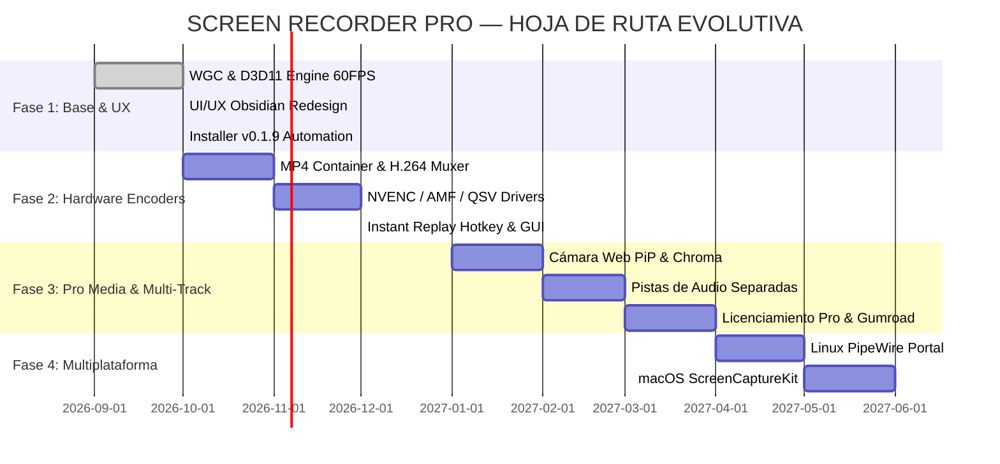

# SPECIFICATION: PRODUCT ROADMAP & COMMERCIALIZATION (GTM) STRATEGY
Document ID: `[SPEC-ROADMAP-001]`
Status: APPROVED / MASTER ROADMAP
Domain: Product Strategy, Commercialization & Architecture Evolution
Version: 1.0.0

---

## 1. Executive Summary & Vision

**Screen Recorder Pro** es una solución de captura de pantalla multiplataforma, de grado comercial y ultra-alto rendimiento (60–120 FPS, latencia de pipeline < 5ms, 0 fugas de memoria) desarrollada 100% en Rust idiomático.

### Visión del Producto
Convertirse en el estándar de oro en grabación de pantalla para creadores de contenido, profesionales de TI, gamers y empresas que exigen:
1. **Rendimiento extremo sin sobrecarga:** Instalador ligero (< 15 MB) y consumo mínimo de CPU (< 2%) y RAM (< 70 MB).
2. **Privacidad absoluta (Local-First):** Grabación local sin telemetría invasiva ni almacenamiento forzado en la nube.
3. **Calidad de estudio instantánea:** Codificación acelerada por hardware (NVENC, AMF, QuickSync, VideoToolbox, VA-API) y repetición instantánea (*Instant Replay*) en búfer RAM circular.

---

## 2. Análisis Competitivo y Posicionamiento de Mercado

| Atributo | **Screen Recorder Pro (Nosotros)** | **OBS Studio** | **Camtasia** | **Loom** | **Bandicam** |
| :--- | :--- | :--- | :--- | :--- | :--- |
| **Tecnología Base** | 100% Rust Seguro (D3D11 / WGC / Vulkan) | C/C++ Monolítico | C++ / .NET Propietario | Electron / WebRTC | C++ Win32 Legado |
| **Tamaño Instalador** | **~10–15 MB** | ~150–200 MB | ~350 MB | ~120 MB | ~35 MB |
| **Huella RAM en Reposo**| **< 65 MB** | ~250–400 MB | ~500 MB+ | ~300 MB | ~90 MB |
| **Latencia de Captura** | **< 5 ms** (Lockstep D3D11/WGC) | 15–30 ms | 40–80 ms | 60–120 ms | 15–25 ms |
| **Modelo de Precios** | Freemium + Pro Lifetime ($29) / Sub ($4.99) | Gratuito / Open Source | $299 upfront o $50/año | $12.50/usuario/mes | $44 por PC (Licencia rígida) |
| **Curva de Aprendizaje**| **Nula** (1-clic con estética Obsidian) | Muy alta (Escenas, filtros) | Media (Editor pesado) | Baja | Media |
| **Privacidad / Cloud** | **100% Local y Privado** | Local | Local | Obligatoriamente en Nube | Local |
| **Instant Replay (RAM)**| **Nativo Sub-10ms** | Requiere plugin / config | No disponible | No disponible | No disponible |

### Propuesta de Valor Única (UVP)
> *"La fluidez y potencia de OBS para gaming y video 4K60, combinada con la inmediatez y elegancia de Loom, empaquetada en un binario Rust de 10 MB que nunca ralentiza tu sistema."*

---

## 3. Modelo de Comercialización y Monetización

Adoptamos una estrategia **Freemium Comercial (Product-Led Growth)**:

### Matriz de Planes y Niveles

| Característica | **Community (Gratuito)** | **Pro Creator ($29 Lifetime o $4.99/mes)** | **Team / Enterprise ($9.99/mes/usuario)** |
| :--- | :---: | :---: | :---: |
| **Resolución Máxima** | Hasta 1080p a 60 FPS | Hasta 4K / 8K a 120 FPS | Hasta 4K / 8K a 120 FPS |
| **Marcas de Agua** | **Sin marca de agua jamás** | Sin marca de agua | Sin marca de agua / Branding corporativo |
| **Formatos de Salida** | AVI (Motion-JPEG de ultra-baja CPU) | MP4 (H.264/HEVC/AV1), MKV, AVI | MP4, MKV, ProRes, WebM |
| **Aceleración por HW** | WGC / D3D11 Compositor | NVIDIA NVENC, AMD AMF, Intel QSV | NVENC Dual-Engine, AMF, QSV, Apple VT |
| **Instant Replay (Buffer)**| 15 segundos en RAM | Hasta 300 segundos (5 min) en RAM | Búfer ilimitado configurable |
| **Cámara Web PiP** | Básica rectangular | PiP circular, croma y eliminación de fondo | PiP multicámara y recorte con IA |
| **Audio Multicanal** | Mezcla estéreo 2 canales | Pistas de audio separadas (Mic + Sistema) | Pistas separadas + Normalización EBU R128 |
| **Soporte & Actualizaciones**| Comunidad / GitHub | Prioritario + Actualizaciones de por vida | SLA dedicado 24/7 y despliegue MSI |

### Estrategia Go-To-Market (GTM)
1. **Canales de Distribución Principales:**
   - **GitHub Releases:** Binarios firmados y portables para la comunidad técnica y entusiastas de Rust.
   - **Windows Package Manager (`winget`):** `winget install screen-recorder-pro`.
   - **Microsoft Store:** Empaquetado MSIX puente de escritorio Win32 para ganar tracción masiva en Windows 11.
   - **Homebrew & Flatpak / Snap:** En el despliegue de fases macOS y Linux.
2. **Campaña de Lanzamiento:**
   - Lanzamiento en **Product Hunt** y **Show HN (Hacker News)** enfatizando "Native Rust, Zero-Electron, Sub-5ms latency".
   - Demostraciones en video comparando la pérdida de FPS en juegos exigentes (Cyberpunk 2077, Valorant) entre OBS y Screen Recorder Pro.
   - Programa de afiliados para streamers y creadores de contenido técnico.

---

## 4. Hoja de Ruta Tecnológica por Fases (Product Roadmap)

### Detalle de Fases

#### Fase 1: Cimientos de Rendimiento & Nueva Experiencia de Usuario (v0.1.8 – v0.2.0) [ACTUAL]
- [x] Captura por hardware WGC y D3D11 a 60 FPS estables sin bloqueo de DWM.
- [x] Sincronización A/V en candado (*Lockstep synchronization*) y búfer de preinicio de audio.
- [ ] **Rediseño Integral de UI/UX** aplicando la paleta y componentes de `./UIUX`:
  - Cabecera con insignia `PRO`, estado del motor y selector de idioma bilingüe (EN/ES).
  - Selector de modo: Monitor Completo, Ventana, Región Libre y Presets.
  - Vúmetros de audio en tiempo real para Altavoces y Micrófono.
  - Tarjetas de destino, cámara PiP y botón de grabación de alto impacto visual.
  - Panel modal de Configuración y Ajustes del Encoder con pestañas y telemetría en vivo.

#### Fase 2: Contenedor MP4 y Codificación por Hardware (v0.3.0 – v0.4.0)
- Multiplexado nativo MP4 (`mp4` / `isom`) con fragmentos sincrónicos.
- Integración de codificación de hardware Direct3D 11 / Media Foundation (NVENC, Intel QuickSync, AMD AMF).
- Guardado instantáneo del búfer de repetición (*Instant Replay Clip*) en disco al pulsar hotkey configurable.

#### Fase 3: Producción Avanzada y Cámara Web PiP (v0.5.0 – v0.9.0)
- Captura de cámara web por DirectShow / Media Foundation superpuesta en vivo sobre la captura de pantalla con redimensionamiento dinámico.
- Grabación de pistas de audio independientes (Track 1: Master, Track 2: Micrófono, Track 3: Audio de Juego).
- Integración del sistema de activación de licencia Pro (licencia offline criptográfica con curvas elípticas Ed25519).

#### Fase 4: Despliegue Multiplataforma y Versión 1.0 (v1.0.0)
- Implementación de backend PipeWire / `xdg-desktop-portal` en `rec-platform-linux`.
- Implementación de backend ScreenCaptureKit y VideoToolbox en `rec-platform-macos`.
- Lanzamiento comercial global.
